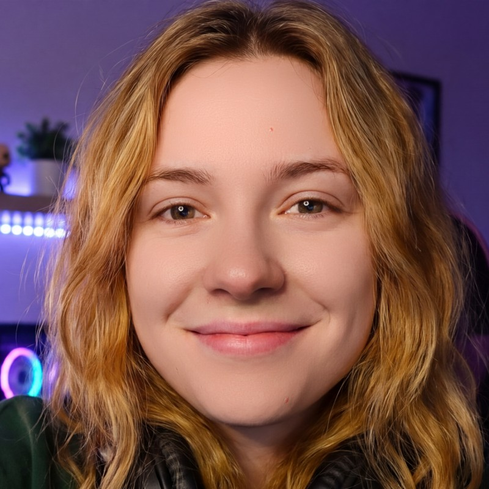
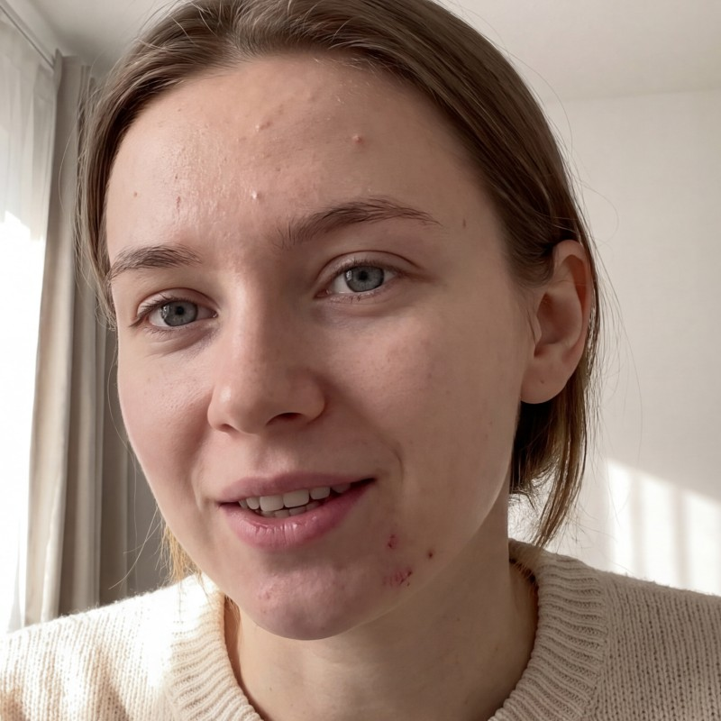
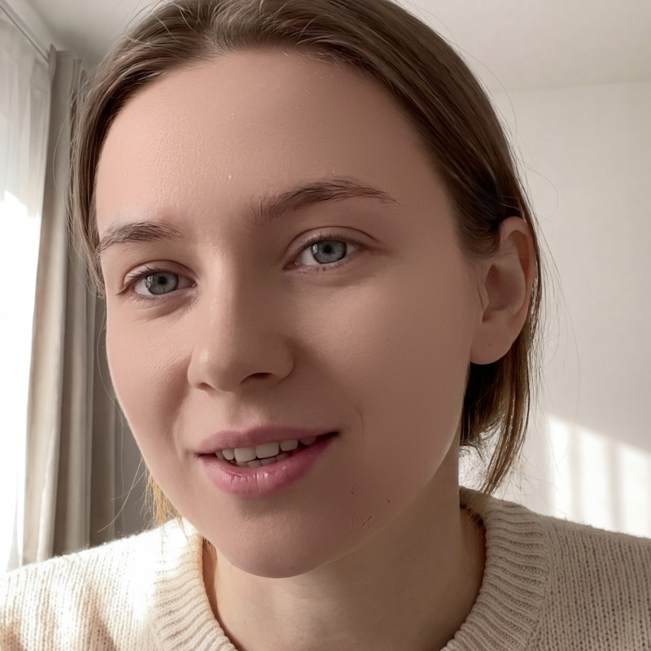
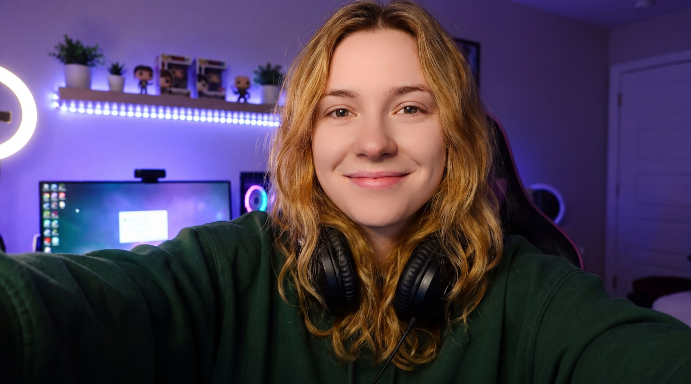
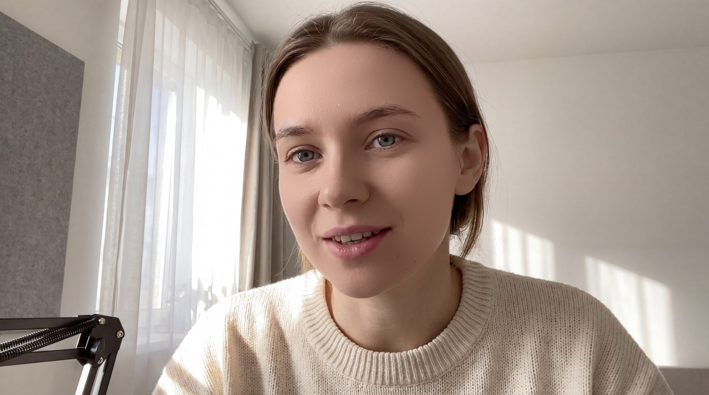

# Beauti

Beauti is an OBS Studio effect filter for real-time skin retouching and finishing.
It finds the largest face in a source and follows it, runs small neural networks
locally (a face detector, a retouching U-Net, a skin segmentation model, and face
landmarks that follow the face and keep eyes, brows, and lips out of the skin mask),
and composes the result on the GPU
in six independent stages: Retouch, Skin Tone, Local Color Smoothing, Micro Dodge &
Burn, Smooth, and Eyes. Eyes adds a small iris model. Everything runs on your
machine; nothing leaves it.

| Original | Beauti, preset High |
| --- | --- |
|  |  |
|  |  |

Full frames

| Original | Beauti, preset High |
| --- | --- |
|  |  |
|  |  |

The demo images are AI-generated (Google Gemini) and show no real people. The
processed versions come unedited from the plugin in OBS (preset High, High
Quality, Apple Acceleration); see [demo images](docs/images/README.md).

## Status

Beauti 0.10.0 is the first public version, for macOS on Apple silicon and Windows x64.
See the [changelog](CHANGELOG.md).

## Requirements

| Platform | Hardware | Software |
| --- | --- | --- |
| macOS | Apple silicon (M1 or later) | macOS 27 or later, OBS Studio 33.0.0 or later |
| Windows | x64; for NVIDIA acceleration a supported NVIDIA RTX GPU (Ampere or newer) with a CUDA 13-capable driver and NVIDIA's runtime files, otherwise the CPU | Windows x64 (validated on Windows 11), OBS Studio 33.0.0 or later |

Windows also requires the current x64
[Microsoft Visual C++ Redistributable](https://learn.microsoft.com/en-us/cpp/windows/latest-supported-vc-redist).

Intel Macs are not supported. One Windows package serves every machine. NVIDIA
acceleration needs four files from NVIDIA, which you add yourself; without them new
filters run on the CPU, which is considerably slower. OBS Studio 33.0.0 is the build baseline on both platforms;
current validation coverage is recorded in [release readiness](docs/RELEASE.md). The
Windows packages use the OBS 33 plugin folder layout (`plugins\beauti\beauti.dll`
with `data\`), which older OBS releases do not load.

## Installation

The [installation guide](docs/INSTALL.md) has the full steps, including NVIDIA
acceleration on Windows.

**macOS.** Quit OBS, extract the package, and copy `beauti.plugin` into
`~/Library/Application Support/obs-studio/plugins/`.

**Windows.** Quit OBS, extract the package, and copy the `beauti` folder into
`%ProgramData%\obs-studio\plugins\`. For NVIDIA acceleration, download NVIDIA's
runtime archive and copy its four DLLs next to `beauti.dll`, then restart OBS.

## Using Beauti

Select a source and choose **Tools → Beauti: Add Filter to Selected Source**, or add
**Beauti** under the source's effect filters.

Choose a **Preset**: Low, Medium, High, Very High, or Manual. New filters start at
**Medium**. Outside Manual only the preset and the processing controls are shown.
Manual shows every effect section, starting from the values of the last selected
preset; your edits are saved with the scene. Selecting a preset replaces the
effect values and never changes the processing settings. See the
[preset table](docs/PRESETS.md).

| Control | What it does | Medium |
| --- | --- | --- |
| Retouch | Reduces blemishes with the retouching model | 70% |
| Skin Tone | Evens out regional skin chroma | 70% |
| Local Color Smoothing | Reduces small skin color variations while retaining lightness | 30% |
| Micro Dodge & Burn | Reduces small lightness variations | 55% |
| Smooth | Reduces skin-detail contrast (Texture) | 40% |
| Eyes | Subtly brightens the iris and eye whites, preserving natural color | 50% |

Stages run in the order shown. Each control ranges from 0 to 100%; zero disables
only that stage, and changes fade in over 150 ms so dragging a slider never flashes
the unprocessed image. Eyes strength follows the selected preset; its iris model
runs only while Eyes is enabled or fading out. Closed, too-small, or uncertain eyes
receive no correction. See [Eyes](docs/EYES.md) for behavior and limits.

High is the reference look. Very High deliberately removes more fine skin
texture while keeping the same eye strength.

In Manual, Smooth exposes four detail reductions, Structure Size, and Edge
Protection; Local Color Smoothing exposes area size and edge protection. Their
values come from the last preset. Strength 0 disables each effect, without extra
switches. See [Texture](docs/TEXTURE.md) and [Local Color](docs/LOCAL-COLOR.md).

Further settings:

- **Quality**: *Performance* (384 px retouch) or *High Quality* (512 px retouch).
  The skin mask always uses 256 px. High Quality costs roughly twice the retouch time.
- **Analysis Resolution**: the longer side of the image the models analyze
  (960, 1280, 1920 px). The output keeps the source resolution.
- **Processing Device**: Apple Acceleration (Core AI: Neural Engine and GPU),
  NVIDIA Acceleration (optionally Full Precision), or CPU. New filters start on
  the accelerator when the machine has one and on the CPU otherwise, which the
  status line then says. If a selected device is unavailable, the status line
  reports the error instead of silently switching.
- **Target Frame Rate**: how often a new analysis is requested. *Automatic* follows the
  canvas rate as far as the computer keeps it steady, and otherwise uses an even fraction of
  it, up to 60 FPS.

The status line shows the analysis size, the measured analysis rate, and the delay of the
displayed frame; **Refresh Status** updates it. It also explains when processing is blocked by a missing
source, an unavailable image size, a source larger than 4096 px on a side, or an
unsupported source or canvas color space. Reopening the filter settings also reads
the current status. The plugin version appears below the settings.

The interface follows the OBS language setting: English, German, Spanish,
Portuguese (Brazil), French, Russian, Japanese, Korean, and Chinese (Simplified
and Traditional). Missing translations fall back to English.

## Limits

- One face: the largest face is processed and followed; others are left untouched. Another
  face takes over only when it stays clearly larger.
- SDR only: sources that are not sRGB, or larger than 4096 px on a side, are
  passed through unchanged. HDR is not validated.
- A failure of up to 300 ms, such as a brief occlusion, is bridged. After that the filter fades
  back to the unprocessed image and resumes automatically when a face returns.
- Frame rate and delay: the whole source shows the frame that was analyzed. While a face is
  processed, its video therefore runs at the analysis rate and arrives slightly late. On an
  M4 Pro the delay is about one frame at 30 FPS (34 ms), and a slower device delays more.
  If the picture leads the sound, set a matching sync offset for the audio source in OBS.
- 4K at a 30 FPS canvas: an M4 Pro delivers 30 processed frames per second in
  both quality modes.

## Privacy

All processing is local. The plugin opens no network connections and disables
ONNX Runtime telemetry. Compiled model caches are stored under
`~/Library/Caches/Beauti` on macOS and `%LOCALAPPDATA%\Beauti\Cache` on Windows;
on macOS, Core AI also keeps its own cache for OBS under
`~/Library/Caches/coreai-cache/`. Deleting these caches is safe; the next start
rebuilds them.

## How Beauti is made

Beauti is developed with the support of AI assistants. They help with writing and
reviewing code, tests, and documentation, and with running builds and
measurements. The work is guided and supervised by people: they set the
direction, make the product decisions, decide which changes are accepted, and
are responsible for the result. Changes go through the same automated checks
(native and Python tests, sanitizers, formatting, provenance), and image quality
is judged by people on real cameras.

## Building and contributing

The repository contains the complete native source, model preparation recipes,
license records, tests, and packaging tools. Generated models and SDKs live in the
ignored `.cache/` directory. On macOS, `cmake --workflow --preset macos` builds and
tests on a clean checkout.

- [Build instructions](docs/BUILD.md)
- [Source layout, formatting, and contributing](CONTRIBUTING.md)
- [Architecture](docs/ARCHITECTURE.md), the [finishing algorithms](docs/FINISHING-OBS.md), and the
  [architecture decisions](docs/decisions/README.md)
- [Tests](docs/TESTING.md) and the [output continuity contract](docs/OUTPUT-CONTINUITY.md)
- [Performance and image-quality acceptance](docs/PERFORMANCE-ACCEPTANCE.md)
- [Apple acceleration (Core AI)](docs/APPLE-ACCELERATION.md)
- [Model preparation](models/README.md), [provenance](docs/PROVENANCE.md), and [dependencies](docs/DEPENDENCIES.md)
- [Release process](docs/RELEASE.md) and [changelog](CHANGELOG.md)

## Licenses

Copyright © 2026 wdominik. Beauti is free software: you can redistribute and modify
it under the terms of the GNU General Public License, version 3 or (at your option)
any later version; see [COPYING](COPYING). It comes without any warranty. An
[additional permission](licenses/GPL-Additional-Permission.txt) allows combining it
with NVIDIA's runtime. Third-party code, models, and libraries are recorded in
[licenses](licenses/) and the [provenance register](docs/PROVENANCE.md). The retouch
model (ModelScope) and the MediaPipe models (face detection, skin segmentation, face
and iris landmarks) are published under the Apache License 2.0.
