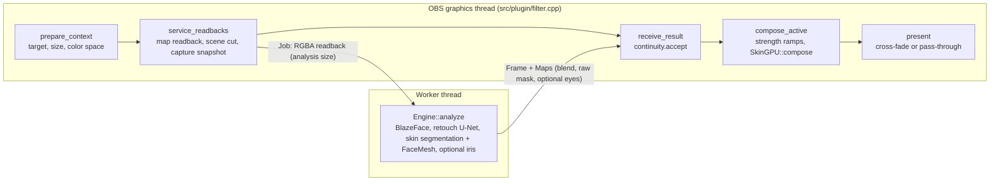
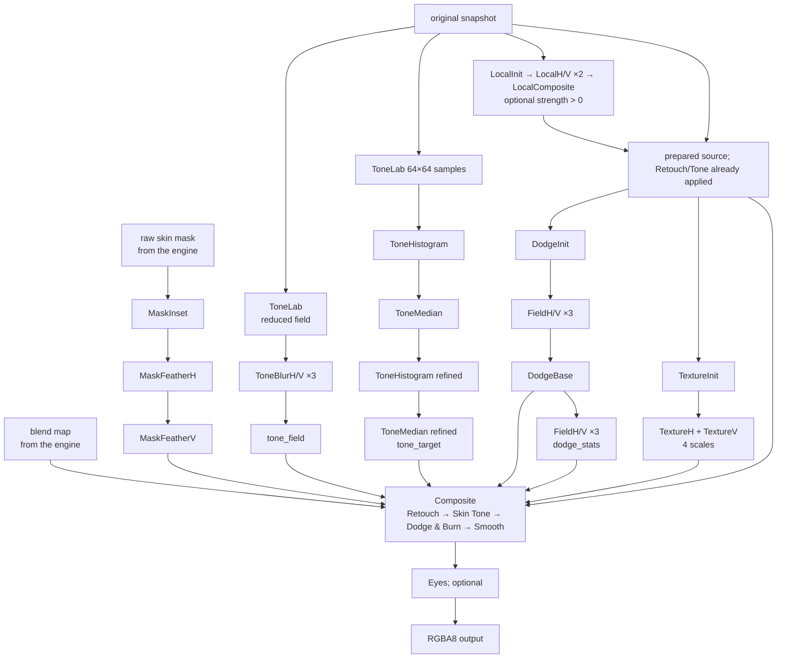

# Architecture

Beauti is a C++20 OBS filter module with two threads and one GPU pipeline. The
render thread captures the source, hands reduced frames to a worker, and composes
the result; the worker runs the neural networks through Core AI on macOS and ONNX
Runtime on Windows and for the CPU device. Python is absent from the runtime path.

## Data flow

Each video frame runs the five steps in order. Readbacks come before receiving a
result: the worker gets its next frame earlier, and a result published meanwhile
is taken in this tick rather than overwritten in the single result slot. A `RenderContext` carries the
source size, the reduced analysis size, the analysis generation, and the time.
Generation changes (source, size, settings, scene cut) drop pending jobs and
results. The worker owns the `Engine`; the graphics thread never runs inference.

The worker reads a reduced analysis image. Full-resolution snapshots stay
associated with analysis results through a `CaptureToken`; bounded queues (eight
snapshot slots, two readback surfaces) and expiry rules prevent unbounded latency.
Structural settings (analysis size, device, quality) invalidate results; strength
changes keep the analysis and ramp from the current value over 150 ms, so dragging
a control never resets the effect. The [output continuity policy](OUTPUT-CONTINUITY.md)
decides when a held result stays visible and when the filter fades to the source.

## GPU composition

`SkinGPU::compose` (`src/plugin/gpu.cpp`) runs the stages of `data/beauti.effect`
on the full-resolution snapshot. Maps uploaded for one analysis are cached by
generation and sequence, so slider-only redraws reuse them.

Local Color optionally materializes the early stages once in half floats; when
disabled, the original composition path is unchanged. Its five pass slots are
LocalInit, LocalH, LocalVEven, LocalVOdd, and LocalComposite. See
[Local Color](LOCAL-COLOR.md) for the guide, bounds, and independent reference.

Skin Tone estimates a reduced regional chroma field; Dodge & Burn and Texture use
full-resolution face-region grids and apply correction to original-resolution
pixels. Semantic mask exclusions protect non-skin regions. Source alpha and pixels
outside the face region are preserved. The largest face is processed. Pass slots
are named by `SkinGPU::Pass`; the tuning constants shared with the CPU references
live in `src/core/tuning.h`, the shader-only ones at the top of `gpu.cpp`.

## Inference

`src/core/engine.cpp` prepares the detector, retouch, and segmenter inputs from the
RGBA readback (shared resize coordinates, SSE2 quantization on Windows x64; every
model takes RGB in [-1, 1]). `src/core/face_tracker.h` decides which face region an
analysis uses ([decisions](DECISIONS.md#face-tracking)): FaceMesh V2 on the
CPU follows an established face from the landmarks of the previous analysis.
MediaPipe BlazeFace (full range, 192 px letterbox) finds a face when none is followed and
checks about once per second for a clearly larger one. The analysis crop is a square of 1.75
landmark extents; it may reach beyond the image, whose edge pixels then repeat, so that a face at
the border or close to the camera reaches the models undistorted. The retouch U-Net then runs on the selected device while a second thread
runs the MediaPipe Multiclass segmenter (256 px) and, overlapping it, Iris for Eyes on the CPU.
The mask is the segmenter's face-skin class with the FaceMesh eye, brow, and lip contours cut
out (grown by 1.5 mask pixels), so no feature is ever treated as skin. Both maps are returned
as RGBA float maps.

`src/backends/` centralizes device and model selection: Core AI on macOS, TensorRT RTX
on Windows, and the CPU everywhere. The retouch and segmenter stages share one
interface (`StageModel`) with an ONNX Runtime and a Core AI implementation. The
segmenter runs on the selected device (Core AI, TensorRT RTX, or the CPU); detection
and landmarks always run on the CPU ([decisions](DECISIONS.md#models-and-their-placement)). Device
initialization failures are reported rather than silently switching the whole
session to CPU; ONNX Runtime can still assign unsupported operators to CPU.

On macOS, Core AI runs the retouch model on the Neural Engine and the segmenter on the
GPU through a Swift adapter with a C interface (`src/backends/coreai.h`); see
[Apple acceleration](APPLE-ACCELERATION.md) and
[decisions](DECISIONS.md#apple-core-ai).

Windows loads the pinned provider DLLs from the module directory with restricted
DLL search flags. One synchronized registration is retained for the module
lifetime; engine-owned sessions die before their environment reference. CPU-only
engines do not load NVIDIA DLLs. Runtime caches are local and offline, keyed by
model, ORT, and provider DLL identities; TensorRT additionally validates cached
code against its runtime/device. Initial compilation occurs on the worker thread.
No process PATH or DLL search policy is changed.

CPU mode uses ONNX Runtime's automatic intra-op thread sizing for the detector,
retouch, and segmenter. FaceMesh and Iris, and with TensorRT RTX or Core AI every CPU
session, use the auxiliary budget: a quarter of the physical cores, two to four, on
Windows, and two elsewhere. Each TensorRT session keeps one host thread; see
[decisions](DECISIONS.md#processing-device) and [decisions](DECISIONS.md#models-and-their-placement).

## Settings

The preset selector writes all effect values before they reach the GPU ramps.
Its property callback hides the effect groups outside Manual; the same code in
`src/plugin/preset_settings.h` handles updates from scripts and saved settings
(see [Presets](PRESETS.md)). Processing values are never
part of a preset.

The filter stores its settings under the keys below (`obs_data_t`, all
integers). From 1.0 the keys are a compatibility contract: renaming or
renumbering one is a major release (see [RELEASE.md](RELEASE.md)); before 1.0 such
changes reset the affected settings instead of migrating them. Values outside the range are
clamped when read; an unsupported device value falls back to the build's default.
Structural settings reconfigure the engine and drop pending results; strength
and rate changes keep the current analysis.

| Key | Control | Values | Default | Effect of a change |
| --- | --- | --- | --- | --- |
| `preset` | Look preset | 0 Manual; 101 Low; 102 Medium; 103 High; 104 Very High | 102 | Writes the preset's effect values; strength ramps as below |
| `retouch` | Retouch | 0 to 100 (percent) | 70 | Strength ramp, 150 ms |
| `skin_tone` | Skin Tone | 0 to 100 | 70 | Strength ramp, 150 ms |
| `dodge_burn` | Micro Dodge & Burn | 0 to 100 | 55 | Strength ramp, 150 ms |
| `smooth` | Smooth (Texture) | 0 to 100 | 40 | Strength ramp, 150 ms |
| `eyes` | Eyes | 0 to 100 | 50 | Strength ramp, 150 ms |
| `smooth_fine` | Finest detail reduction | 0 to 100 | 35 | GPU-only ramp, 150 ms |
| `smooth_small` | Fine detail reduction | 0 to 100 | 90 | GPU-only ramp, 150 ms |
| `smooth_medium` | Medium detail reduction | 0 to 100 | 80 | GPU-only ramp, 150 ms |
| `smooth_broad` | Broad detail reduction | 0 to 100 | 25 | GPU-only ramp, 150 ms |
| `smooth_size` | Structure Size | 50 to 200 | 115 | GPU-only ramp, 150 ms |
| `smooth_edges` | Edge Protection | 0 to 200 | 110 | GPU-only ramp, 150 ms |
| `local_color` | Local Color strength | 0 to 100 | 30 | GPU-only ramp, 150 ms; 0 bypasses stage |
| `local_color_size` | Color Area Size | 25 to 300 | 110 | GPU-only ramp, 150 ms |
| `local_color_edges` | Local Color Edge Protection | 0 to 200 | 100 | GPU-only ramp, 150 ms |
| `native_quality` | Quality | 0 Performance (384 px retouch), 1 High Quality (512 px retouch); the skin mask is 256 px in both | 0 | Structural: model reload |
| `native_size` | Analysis Resolution | longer side in pixels; list offers 960, 1280, 1920; stored values are clamped to 640 to 1920 | 1280 | Structural: new analysis size |
| `native_backend` | Processing Device | `beauti::Backend`: 0 Apple (Core AI), 2 CPU, 3 TensorRT RTX, 4 TensorRT RTX Full Precision (1 is unassigned); only the build's choices are offered | first choice of the build when the machine has its accelerator (Core AI on macOS, TensorRT RTX Full Precision on Windows with a supported NVIDIA RTX GPU/driver), else CPU | Structural: provider and model reload |
| `native_fps` | Target Frame Rate | 0 (automatic), or 1 to 60 analyses per second | 0 | Scheduling only; the compositor and models are unchanged ([decisions](DECISIONS.md#timing)) |

The effect defaults are the Medium preset. Before 1.0, saved effect settings
that do not fit the current catalog are reset to these defaults rather than
migrated ([Presets](PRESETS.md#saved-settings-before-10)).

Effect sections use `OBS_GROUP_NORMAL`; their names are presentation-only and add
no checkbox or persisted mode. `status`, `refresh`, and `version` are display-only properties and are not
stored. Source blockers have priority over worker status. The render thread
publishes a separate, mutex-protected message on a source-state transition; the
properties callback reads it when opened or refreshed. Worker completion cannot
hide that message. Recovery clears the blocker and starts a new generation with
the normal starting/analysis status. No OBS properties are updated from the worker
or graphics thread. This policy is shared by Windows and Mac, including CPU mode.
Defaults and their rationale are recorded in
[decisions](DECISIONS.md#controls-and-presets); the device default follows
[decisions](DECISIONS.md#nvidia-tensorrt-rtx),
[decisions](DECISIONS.md#apple-core-ai), and
[decisions](DECISIONS.md#processing-device).

## References and tests

`src/effects/` implements portable CPU finishing references used by the numerical
tests; the shader in `data/beauti.effect` is compared against them. Floating-point
interpolation, sampled color statistics, and RGB8 rounding prevent a claim of
bit-identical CPU/GPU output. `tools/benchmarks/worker.cpp` exposes the engine as a
headless process for tests and benchmarks. Model export and preparation live under
`tools/beauti_tools/models/`; they are part of the reproducible build, not of the runtime.

See [finishing](FINISHING-OBS.md), [tests](TESTING.md), and
[provenance](PROVENANCE.md) for exact boundaries, and
[decisions](DECISIONS.md) for the decisions behind this structure.

## Optional eye enhancement

`Frame::eyes` requests worker-owned FaceMesh V2 and Iris inference. Sessions are
created lazily and retained until engine destruction; disabled filters perform no
eye inference or map upload. Both sessions use CPU execution and the auxiliary
thread budget, independent of the skin pipeline provider. The detector's unclipped face ROI and eye
keypoints supply a rotated crop; the clipped analysis crop is unchanged. FaceMesh
also runs for the skin mask, so its session is created with the engine and only the
Iris session is lazy.
`src/core/eyes.cpp` creates a 512-square RGBA map (R iris ring, G sclera) in that
same clipped skin ROI. Maps belong to the captured frame and its revision; there
is no reuse of landmarks across frames. V2 lids gate blink closure before Iris
inference and bound masks after refinement. Invalid estimates produce no eye map.

The render thread samples a fifth 150 ms ramp and uploads the map once per
revision. Enabling waits for an eye-requested analysis before ramping in; disabling
keeps requesting eye maps during the fade. After the existing Composite pass, an
optional Eyes pass applies linear-light correction to full-resolution pixels.
This separate pass respects OBS's eight-texture-per-shader limit and preserves the
existing pipeline exactly at Eyes=0. Missing maps force zero eye strength even if
an older eye texture remains allocated. See [Eyes](EYES.md) for model identities,
mask guards, tuning, and validation.
